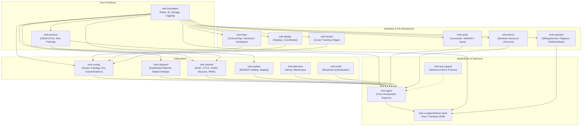
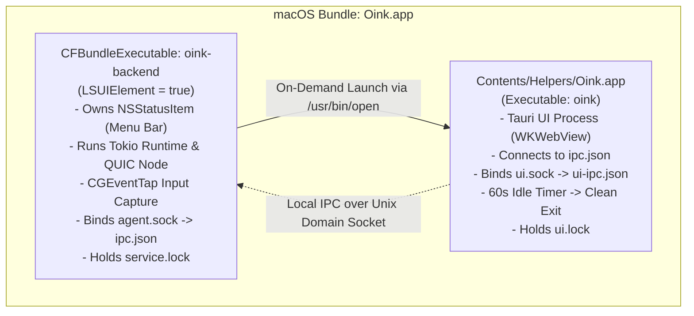
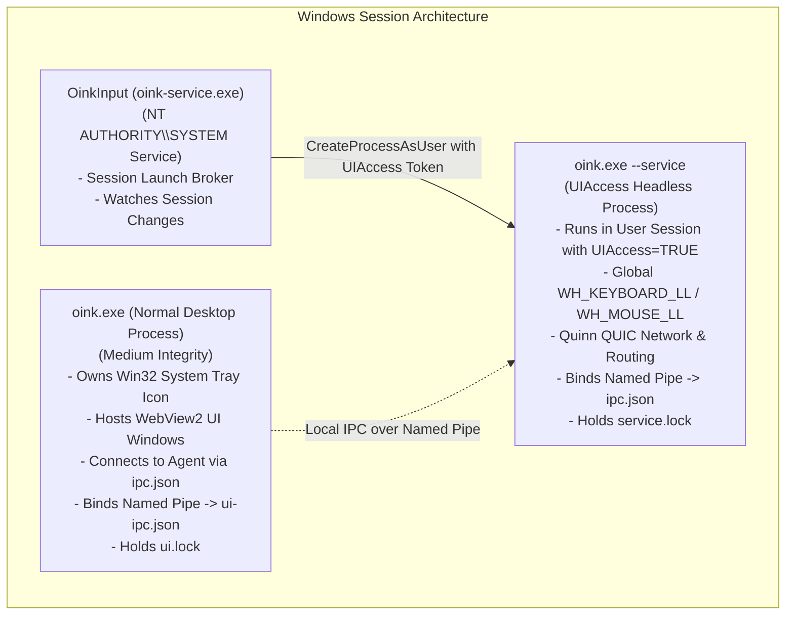
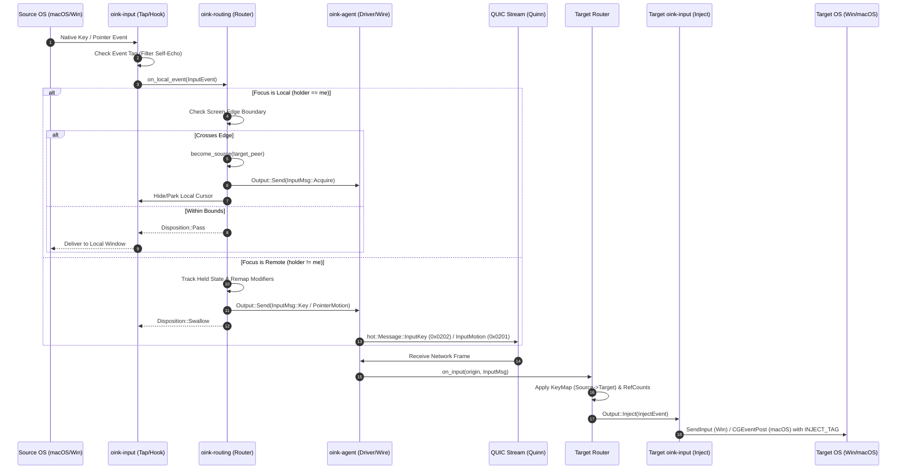
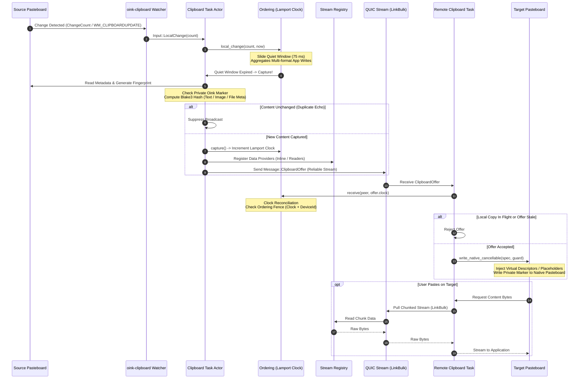
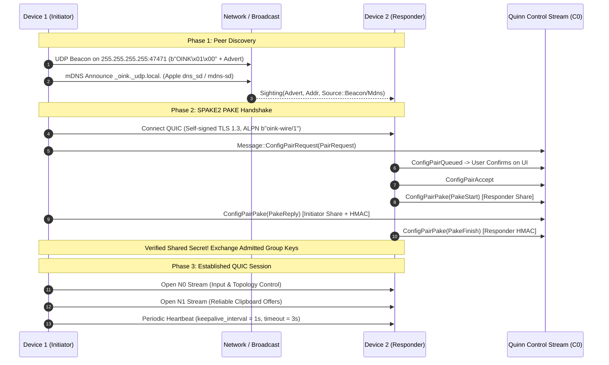
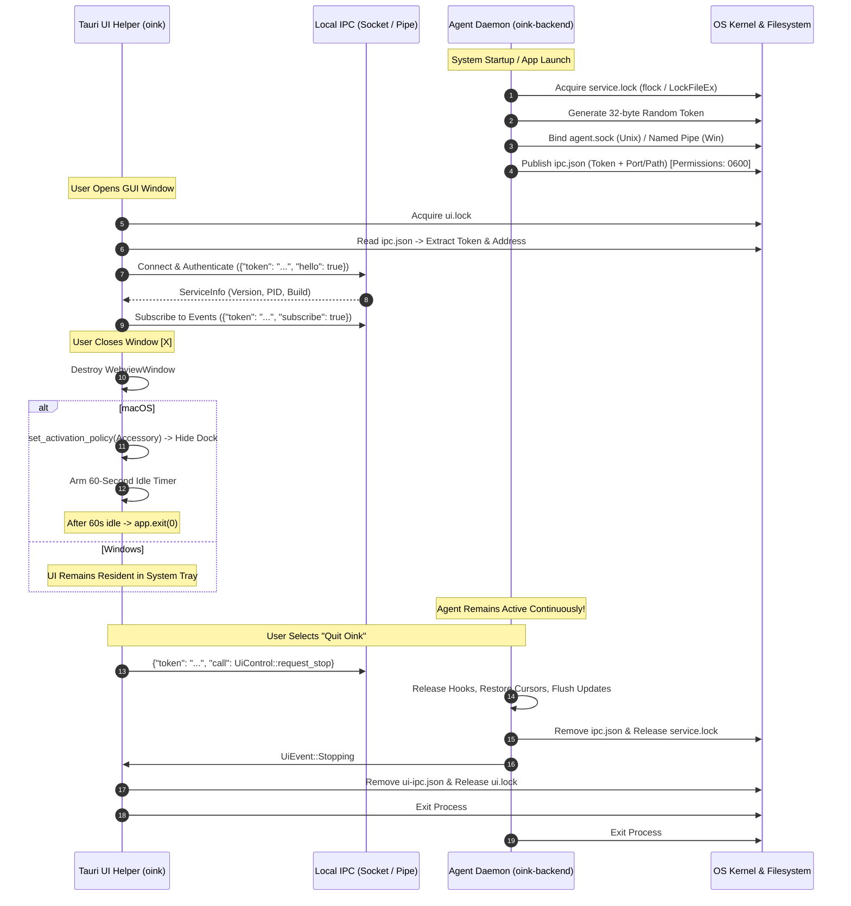
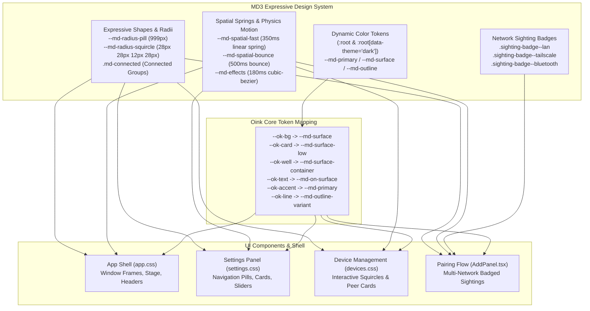
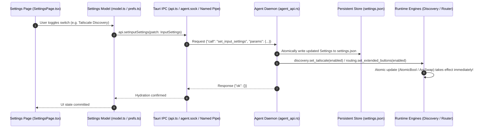

# Oink System Architecture

## 1. System Overview & Design Philosophy

Oink is a high-performance, secure cross-device input sharing and clipboard synchronization system designed primarily for seamless interaction between macOS and Windows. 

### Core Design Principles
1. **Asymmetric Separation of Concerns**: Complete separation between the persistent background daemon (`oink-agent` / `oink-backend`) and the transient user interface (`oink-ui` via Tauri). The background agent must never crash or terminate when windows close, WebViews crash, or the user logs out.
2. **Zero-Trust Peer Security**: Devices communicate over QUIC (via Quinn) encrypted with mutual TLS 1.3 (`rustls`). Peer identity is cryptographically tied to raw Ed25519 public keys (`DeviceId`). Discovery and pairing employ SPAKE2 Password-Authenticated Key Exchange (PAKE), ensuring zero exposure of unencrypted metadata or private keys over local networks.
3. **Low-Latency Direct Path**: Input events bypass high-overhead serialization frameworks; raw HID usage codes and mouse deltas are streamed over QUIC streams with minimum framing overhead.
4. **Resilient Clipboard Semantics**: Distributed clipboard synchronization utilizes Lamport logical clocks with deterministic `DeviceId` tie-breaking to avoid distributed split-brain or infinite echo loops. Virtual placeholders ensure that multi-gigabyte files or directories are transferred strictly on-demand.

---

## 2. Workspace Crate Dependency Graph

Oink is organized as a Cargo workspace with 17 crates adhering to strict layering constraints.

### Workspace Crate Responsibilities

| Crate | Responsibility | Platform Dependencies |
|---|---|---|
| **`oink-foundation`** | Crockford Base32 `DeviceId`, secure atomic file storage (`0o600` on Unix, explicit owner DACL on Windows), process priority, path resolution (`LOCALAPPDATA` vs `Application Support`). | `windows-sys`, `libc`, `ed25519-dalek` |
| **`oink-protocol`** | Wire serialization, bounded framing, CBOR code generation (`minicbor`), capability admission, discovery protocol magic `b"OINK\x01\x00"`. | Architecture-neutral |
| **`oink-input`** | OS-level keyboard/mouse capture and injection. Translates native keycodes to/from neutral HID `KeyCode`. Quicker compatibility mode with atomic telemetry (`quicker_compat.rs`), Windows mouse button > 5 graceful handling. | macOS: `objc2-app-kit`, `objc2-core-graphics`. Windows: `windows` (Win32 Hook, `SendInput`) |
| **`oink-locator`** | Display geometry, cursor tracking, edge pressure zones, and crossing barriers. | Multi-platform |
| **`oink-display`** | Display layout representation, multi-monitor configuration, coordinate normalization. | Multi-platform |
| **`oink-routing`** | Central routing engine (`Router`). Screen switching, modifier retargeting, held-key reference counts, local click dispatch, menu masking, peer disconnect cleanup regression protection. | Multi-platform |
| **`oink-clipboard`** | OS clipboard monitoring (polling vs events), 75 ms quiet aggregation, Blake3 content hashing, internal echo markers, lazy virtual file transfers. Stripped of all local file path logging for privacy. | macOS: AppKit `NSPasteboard`. Windows: Win32 Clipboard, OLE `IDataObject` |
| **`oink-network`** | QUIC transport (`quinn`), mutual TLS with self-signed Ed25519 certificates, UDP beacon broadcasting, DNS-SD/mDNS, SPAKE2 PAKE handshake, Tailscale mesh discovery (`discovery/tailscale.rs`), Bluetooth PAN tracking (`discovery/pan.rs`), dynamic network change detection. | macOS: `dns_sd.h` (`libSystem`). Windows: `mdns-sd` (pure-Rust) |
| **`oink-audio`** | Bidirectional low-latency audio streaming using Opus codec. | macOS: CoreAudio HAL / Aggregate Devices. Windows: WASAPI / VB-CABLE |
| **`oink-autostart`** | System startup integration. | macOS: `SMAppService`. Windows: `HKCU\Run` & Task Scheduler |
| **`oink-winsvc`** | Windows SYSTEM Service (`OinkInput`), UIAccess process broker, pre-login Credential Provider. | Windows only |
| **`oink-update`** | Auto-update verification with hardcoded Ed25519 root trust anchors, transactional directory staging, and rollback support. | Multi-platform |
| **`oink-telemetry`** | Sentry client integration, opt-in metrics, crash minidump reporting. | Multi-platform |
| **`oink-crash`** | Crash handler process, minidump generation, stack symbolication. | Multi-platform |
| **`oink-agent`** | Orchestrator daemon. Spawns Tokio runtime, hosts actors for network, clipboard, and input, exposes local authenticated IPC (`ipc.json`), LaunchAgent CLI management (`service_manager.rs`), Windows unprivileged dev-mode fallback. | Multi-platform |
| **`apps/oink/src-tauri`** | Tauri 2.12 desktop shell, WebView2 / WKWebView presenter, system tray, UI IPC client. | Multi-platform |
| **`tests/support`** | Integration testing support, mock peers, network latency simulation. | Multi-platform |

---

## 3. Platform Process Topologies

Oink executes in distinct platform topologies tailored to the security and windowing models of macOS and Windows.

### macOS Process Topology
On macOS, the core agent runs as an `LSUIElement` background application hosting the status bar menu item. The Tauri UI helper runs on-demand as a separate application bundle.

### Windows Process Topology
Windows enforces User Interface Privilege Isolation (UIPI). Injecting input into elevated applications (e.g. Task Manager, UAC prompts) requires a dedicated process running with `UIAccess = TRUE`.

---

## 4. The 4 Core Calling Chains

### Chain 1: Input Capture, Routing & Target Injection

Traces the complete path of mouse motion and key events from OS capture on the source machine to OS injection on the target machine.

#### Detailed Execution Steps:
1. **OS Capture**:
   - macOS (`crates/oink-input/src/macos/tap.rs`): `CGEventTap` handles `kCGEventKeyDown`, `kCGEventKeyUp`, `kCGEventFlagsChanged`, and pointer moves. Modifiers are synthesized from `CGEventFlags` transitions. Events tagged with `MAGIC = 0x4f494e4b` are discarded.
   - Windows (`crates/oink-input/src/windows/hook.rs`): `WH_KEYBOARD_LL` and `WH_MOUSE_LL` intercept raw input. Events tagged with `dwExtraInfo == INJECT_TAG` are passed through.
2. **Routing Arbitration** (`crates/oink-routing/src/router.rs`):
   - Local pointer motion is evaluated against display boundaries (`layout.exit_through_edge`).
   - Crossing triggers `become_source(target)`: parks local cursor, retargets held modifiers (`Shift`, `Ctrl`, `Alt`, `GUI`), and sends `InputMsg::Acquire`.
   - Normal remote events are swallowed locally and emitted as `Output::Send`.
3. **Wire Encoding & Transport** (`crates/oink-agent/src/threads/input/driver.rs`):
   - Motion is coalesced if network backpressure occurs (`flush_motion_for`).
   - Keystrokes are encoded as CBOR frames (`0x0202`) and dispatched over the Quinn QUIC stream.
4. **Target Injection** (`crates/oink-input/src/macos/inject.rs` & `windows/inject.rs`):
   - Target translates neutral HID `KeyCode` back to native virtual keys or scancodes.
   - Modifiers update internal state bitmasks.
   - Native OS API injects event (`SendInput` with `INJECT_TAG` on Windows; `CGEventPost` with user data on macOS).

---

### Chain 2: Clipboard Discovery, Deduplication & Stream Transfer

Traces clipboard change observation, quiet window aggregation, cryptographic hashing, and lazy content transfer.

#### Detailed Execution Steps:
1. **Change Detection**: macOS polls `changeCount` every 75 ms; Windows listens for `WM_CLIPBOARDUPDATE`.
2. **Quiet Period Aggregation**: A 75 ms sliding window (`SOURCE_QUIET_PERIOD`) coalesces successive clipboard formats written by copying applications (e.g. Rich Text followed by Plain Text).
3. **Capture & Deduplication**:
   - Inspects native clipboard for private markers (`MARKER_MAC` / `MARKER_WINDOWS`). If found, capture aborts (echo elimination).
   - Generates Blake3 fingerprint across text (normalized UTF-8), images (normalized RGBA8), and files (metadata only: name, size, mtime; file contents are never hashed).
4. **Ordering & Lamport Clocks**: Increments Lamport clock and persists state to `clipboard-clock.json`. Emits `Message::ClipboardOffer`.
5. **Target Application & Lazy Fetch**: Target receives offer, validates against Lamport tie-breaker, and injects placeholders into the native pasteboard. Heavy payloads and files are lazily streamed across low-priority bulk streams only upon user paste.

---

### Chain 3: Network Discovery, SPAKE2 PAKE & QUIC Links

Traces peer discovery over UDP beacons and mDNS, SPAKE2 mutual authentication, and TLS 1.3 QUIC connection establishment.

#### Detailed Execution Steps:
1. **Discovery**:
   - UDP beacons broadcasted on port `47471` every 2s across all non-loopback IPv4 interfaces (`local_ipv4()`).
   - mDNS advertises `_oink._udp` with TXT records specifying `wire=1`, `id=<hex_device_id>`, `gid=<group_id>`.
   - Direct unicast query/reply (`DiscoveryQuery` / `DiscoveryReply`) verifies endpoints.
2. **SPAKE2 PAKE Pairing**:
   - Initiator displays a 6-digit code. Responder inputs code.
   - PAKE exchange establishes a cryptographic shared secret and verifies the transcript.
   - Nodes exchange Ed25519 `DeviceId`s and commit to `group-state.json`.
3. **QUIC Session Management**:
   - Quinn endpoint connects using mutual TLS 1.3. The SPKI in the self-signed certificate matches `DeviceId`.
   - Control stream `N0` supervises topologies, focus states, and heartbeats (1s ping, 3s timeout).

---

### Chain 4: Agent Daemon Lifecycle, Local Authenticated IPC & Tauri UI Presentation

Traces the process lifecycles, mutual exclusion locks, authenticated IPC, and graceful shutdown.

#### Detailed Execution Steps:
1. **Agent Startup**: Acquires `service.lock`, generates ephemeral 32-byte secret token, binds domain socket/named pipe, writes `ipc.json` with restricted permissions (`0600`).
2. **UI Connection**: Reads `ipc.json`, authenticates every JSON envelope via `token`, and opens event subscription stream.
3. **Closing Windows**: WebViews are destroyed to free memory (~15 MB footprint); on macOS, an idle timer terminates the UI after 60 seconds; on Windows, the process remains in the tray. The backend agent **never** shuts down when windows close.
4. **Shutdown**: "Quit Oink" triggers a clean drain sequence: hooks uninstalled, network sessions disconnected, locks and endpoint files unlinked.

---

## 5. State Files, Identity & Security Model

### Directory Resolution
Configured via `oink_foundation::paths`:
- **macOS**: `~/Library/Application Support/Oink` (Data), `~/Library/Caches/com.hachiwii.oink` (Cache), `~/Library/Logs/Oink` (Logs).
- **Windows**: `%LOCALAPPDATA%\Oink` (strictly excludes roaming `%APPDATA%`).
- **Environment Override**: `OINK_HOME` isolates all runtime paths for testing.

### Key State Files
- `device.key`: 32-byte raw Ed25519 seed. Formatted into 12-character Crockford Base32 `DeviceId` (`XXXX-XXXX-XXXX`). Unix mode `0600`; Windows owner-only DACL.
- `group-state.json`: Group membership list, admitted peer public keys, display arrangements, and pairing commitments.
- `clipboard-clock.json`: Lamport logical clock counter.
- `settings.json`: Local preferences (audio, routing edge resistance, Quicker compatibility, hotkeys).
- `service.lock` / `ui.lock`: OS-level mutual exclusion locks (`flock` on Unix; `LockFileEx` on Windows).
- `ipc.json` / `ui-ipc.json`: Ephemeral connection info containing socket path / pipe name and 32-byte hex token.

### Security Guarantees
- **No Unauthenticated IPC**: Every request must provide the exact matching 32-byte hex token.
- **Mutual TLS**: QUIC sessions require peer certificates signed by their claimed Ed25519 identity key.
- **Clipboard Isolation**: Pasteboard markers prevent recursive echo loops; Universal Clipboard promises are never read without explicit user paste.

---

## 6. MD3 Expressive Presentation & UI Architecture

The desktop presentation layer (`apps/oink`) leverages a comprehensive **Material Design 3 Expressive (MD3 Expressive)** design system (`apps/oink/src/styles/md3-expressive.css`) wrapped in Tauri 2.12 (WKWebView on macOS, WebView2 on Windows).

### 1. Dynamic Color Roles & Surface Hierarchy
- **Light & Dark Mode Palettes**: Full MD3 Expressive tonal palettes defined in `:root` and `:root[data-theme='dark']`.
  - Roles: `--md-primary`, `--md-on-primary`, `--md-primary-container`, `--md-on-primary-container`, `--md-secondary-container`, `--md-tertiary-container`.
  - Surface Hierarchy: Five progressive elevation levels (`--md-surface`, `--md-surface-low`, `--md-surface-container`, `--md-surface-high`, `--md-surface-highest`).
  - Core Oink Variable Mapping: Seamlessly bridges legacy `--ok-*` variables to MD3 tokens (`--ok-bg`, `--ok-surface`, `--ok-card`, `--ok-well`, `--ok-text`, `--ok-accent`, `--ok-line`).

### 2. Expressive Shapes & Morphing Radii
- **Pill Buttons**: Full pill border-radius (`--md-radius-pill: 999px`) on primary action buttons, tabs, and navigation items.
- **Expressive Squircles**: Asymmetric organic corners (`--md-radius-squircle: 28px 28px 12px 28px` and `--md-radius-squircle-alt: 32px 8px 32px 32px`) applied to device cards, stage targets, and active focus indicators.
- **Connected Button Groups (`.md-connected`)**: Outer corners retain squircle curvature (`28px 8px 8px 28px` / `8px 28px 28px 8px`) while inner dividers are flattened, eliminating visual clutter.

### 3. Spatial Spring Motion & Physics
- Motion uses authentic spring physics curves via the modern CSS `linear()` function rather than artificial cubic beziers:
  - `--md-spatial-fast`: `350ms linear(0, .234 7%, .773 22%, 1.06 40%, 1.039 58%, .994 78%, 1)` for snappy micro-interactions and hover expansions.
  - `--md-spatial-bounce`: `500ms linear(...)` for celebratory pairing completions and edge crossings.
  - `--md-effects`: `180ms cubic-bezier(.2, 0, 0, 1)` for subtle opacity and color transitions.

### 4. Multi-Network Discovery Sighting Badges
To provide immediate visual clarity on how a peer device is reachable, `AddPanel.tsx` and `PeerInfo` render specialized tonal badges:
- **LAN Badge (`.sighting-badge--lan`)**: Green tonal container (`--md-badge-lan-bg`) indicating standard local subnet discovery (source 0/1/subnet).
- **Tailscale Badge (`.sighting-badge--tailscale`)**: Purple tonal container (`--md-badge-tailscale-bg`) indicating Tailscale mesh connectivity (source 3 / `100.64.0.0/10`).
- **Bluetooth PAN Badge (`.sighting-badge--bluetooth`)**: Blue tonal container (`--md-badge-bluetooth-bg`) indicating direct Bluetooth PAN point-to-point link (source 4 / `172.20.10.0/28` or link-local).

---

## 7. Settings Schema, IPC Serialization & Runtime Toggles

To provide complete user agency over all M1–M4 capabilities, Oink establishes a bidirectional settings synchronization loop between the Tauri UI and the backend daemon.

### 1. Milestone M1–M4 Settings Specification

| Setting Key (UI) | Wire JSON Field | Rust Struct Location | Default | Runtime Target & Effect |
|---|---|---|:---:|---|
| **`tailscaleDiscovery`** | `tailscale_discovery` | `crates/oink-agent/src/config.rs::Settings` `crates/oink-agent/src/api.rs::InputSettings` | `true` | **`Discovery::set_tailscale(bool)`**: Enables/disables active `tailscale status --json` querying and peer unicast UDP beaconing. |
| **`bluetoothPanDiscovery`** | `bluetooth_pan_discovery` | `crates/oink-agent/src/config.rs::Settings` `crates/oink-agent/src/api.rs::InputSettings` | `true` | **`Discovery::set_bluetooth_pan(bool)`**: Enables/disables Bluetooth PAN (`bnep0`) and link-local (`169.254.0.0/16`) subnet broadcasts and source tagging. |
| **`extendedMouseButtons`** | `extended_mouse_buttons` | `crates/oink-routing/src/config.rs::RoutingSettings` `crates/oink-agent/src/api.rs::InputSettings` | `true` | **`Router::on_input` & `inject`**: Toggles capturing, forwarding, and diagnostic telemetry for 5+ button mice (`MouseButton::Other(5..=7)`). |
| **`destroyWebViewOnClose`** | `destroy_webview_on_close` | `crates/oink-agent/src/config.rs::Settings` `crates/oink-agent/src/api.rs::InputSettings` | `true` *(macOS)* | **`apps/oink/src-tauri/src/shell.rs`**: Destroys WebView memory when settings window closes and terminates UI helper after 60s idle. |

### 2. Backward Compatibility & Serde Fallbacks
All new settings fields in `crates/oink-agent/src/api.rs` and `config.rs` utilize `#[serde(default = "default_true")]`. This ensures that existing `settings.json` files on disk generated by upstream or earlier builds deserialize safely without missing-field errors, defaulting all enhanced capabilities to active.

### 3. Frontend Settings Schema & Localization
The settings schema in `apps/oink/src/settings/schema.tsx` groups these toggles into logical domains:
- **`network` Section (`NetworkIcon`)**:
  - `tailscaleDiscovery`: Labeled *Tailscale 自动发现*, searchable with keywords *Tailscale, VPN, 跨网段, 100.64*.
  - `bluetoothPanDiscovery`: Labeled *蓝牙 PAN 与直连网卡发现*, searchable with keywords *蓝牙, PAN, 直连, 169.254, BNEP*.
- **`input` Section (`MouseIcon`)**:
  - `extendedMouseButtons`: Labeled *扩展鼠标侧键 (6–8 键)*, searchable with keywords *鼠标, 侧键, 6键, 7键, 8键*.
- **`general` Section (`GeneralIcon`)**:
  - `destroyWebViewOnClose`: Labeled *关闭窗口时释放 WebView*, configured with `only: 'mac'`.
- **Multilingual Support**: All schema labels, descriptions, and search keywords are localized across English (`en.ts`), Simplified Chinese (`zh-CN`), Japanese (`ja.ts`), and Korean (`ko.ts`).

