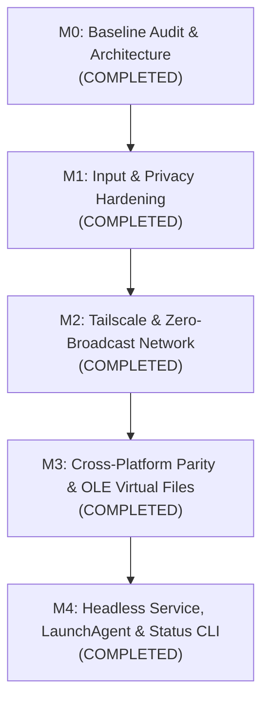

# Oink Fork Plan & Roadmap

## 1. Executive Summary & Baseline State

- **Upstream Repository**: `https://github.com/oinkvm/oink.git`
- **Baseline Release**: Oink `0.3.6` (Build `306001`)
- **Baseline Commit**: `c15f2754f0469a25920eb389c97eacbe9b2c529a` (tagged `v0.3.6` at `a4d1b03`)
- **Toolchain**: Rust 2024 edition, compiler 1.99.0+, Cargo resolver v3
- **Platform Support**: macOS (13+ / Ventura, Sonoma, Sequoia; ARM64 & x86_64) and Windows (Windows 10/11 x64)

### Purpose of the Fork
Oink provides a high-performance, secure cross-device input sharing and clipboard synchronization solution between macOS and Windows using QUIC (over UDP) and mutual TLS 1.3 with Ed25519 identity. However, production multi-device workflows and varied enterprise / home network environments present specific challenges:
1. **Network Environments without Broadcast**: Many modern setups span mesh VPNs (Tailscale, WireGuard), distinct subnets, or direct point-to-point links (e.g. Bluetooth PAN, direct Ethernet) where UDP subnet broadcast and standard multicast DNS (mDNS) are blocked or non-functional.
2. **Third-Party Automation & Tooling Incompatibilities**: Automation software on Windows (specifically Quicker) has subtle interactions with low-level Windows hooks, requiring refined compatibility and telemetry.
3. **Privacy Hardening**: Diagnostic logs must never compromise user privacy by recording absolute local file paths or copied content.
4. **Headless & Service Ergonomics**: Developers and server operators require robust headless operation, simplified LaunchAgent registration on macOS, and development fallbacks for Windows when the elevated service is not installed.

---

## 2. Strategic Objectives of the Fork

1. **Robust Network Interoperability**:
   - Seamless discovery and QUIC connectivity across Tailscale networks without manual port forwarding.
   - Zero-configuration connectivity over Bluetooth PAN (Personal Area Network) and direct Ethernet link-local addresses (`169.254.0.0/16`).
   - Dynamic network change detection without relying exclusively on polling or wake events.
2. **Input Reliability & Parity**:
   - Full support for multi-button mice (>5 buttons) across macOS and Windows with telemetry.
   - Key-repeat and network jitter mitigation for wireless connections.
   - Comprehensive modifier chord synchronization (`Cmd` vs `Ctrl`, `MacFeel`, edge transitions).
3. **Data Privacy & Telemetry Guardrails**:
   - Zero path leakage in clipboard file transfer logs.
   - Anonymized diagnostic tokens for troubleshooting.
4. **Lifecycle & Deployment Ergonomics**:
   - First-class CLI service management (`oink-agent service install/uninstall/status`).
   - Transparent developer-mode fallback on Windows when running unprivileged local builds.
   - Tunable UI idle timeout policies.

---

## 3. Milestones Breakdown & Implementation Status

### M0: Baseline Audit, Architecture & Test Matrix (Completed)
- **Status**: Finished.
- **Deliverables**:
  - Full codebase audit across build systems, input routing, clipboard synchronization, network protocols, and process lifecycles.
  - Baseline documentation suite: `FORK_PLAN.md`, `ARCHITECTURE.md`, `COMPATIBILITY.md`, `TEST_MATRIX.md`.
  - Identification of test discrepancies and privacy log issues.

---

### M1: Input Telemetry, Mouse Buttons & Clipboard Privacy (Completed)
- **Status**: Finished.
- **Completed Tasks**:
  1. **Clipboard Privacy Leaks Remediated**:
     - `crates/oink-clipboard/src/macos/files.rs`: Replaced full file paths with sanitized counts and generic error descriptions.
     - `crates/oink-clipboard/src/windows/files.rs`: Removed local path formatting from warning logs.
     - `crates/oink-clipboard/src/windows/vfile.rs`: Stripped virtual file names from trace logs.
  2. **Cargo Manifest Warning Fixed**:
     - Resolved `crates/oink-clipboard/Cargo.toml` duplicate build target by extracting integration test to `crates/oink-clipboard/tests/native_linked_promise.rs`.
  3. **Quicker Diagnostics & Telemetry**:
     - Added `UNTAGGED_INJECTIONS` and `SKIPPED_EVENTS` atomic counters in `crates/oink-input/src/quicker_compat.rs`.
     - Exposed `QuickerDiagnostics` on `InputBackend` and via `quicker_diagnostics()`.
  4. **Windows Extended Mouse Button Handling**:
     - Audited buttons 1–5 (`Left`, `Right`, `Middle`, `Back`/`XBUTTON1`, `Forward`/`XBUTTON2`).
     - Safely handled buttons > 5 (`MouseButton::Other(5..=7)`): gracefully returns `None`, logs debug, and increments `UNSUPPORTED_BUTTON_COUNT` atomic telemetry counter.
  5. **Routing Regression Test Hardening**:
     - Added comprehensive tests in `crates/oink-routing` for peer disconnect cleanup, held key drops, and cross-platform modifier transforms (`Cmd` <-> `Ctrl`).
  6. **Extended Mouse Buttons Toggle**:
     - Added `extended_mouse_buttons: bool` (default: true) to `RoutingSettings` and `InputSettings`.
     - Wired through local IPC to dynamically enable/disable 6–8 button forwarding and telemetry.
     - Added user-facing switch in `apps/oink/src/settings/SettingsPage.tsx` under *Input* section.

---

### M2: Tailscale & Zero-Broadcast Network Discovery (Completed)
- **Status**: Finished.
- **Completed Tasks**:
  1. **Tailscale Discovery Connector**:
     - Created `crates/oink-network/src/discovery/tailscale.rs` with `TailscaleDiscovery`.
     - Queries `tailscale status --json`, filters active peers in `100.64.0.0/10`, and executes unicast `Discovery::query`.
     - Emits sightings with `Source::Tailscale` (mapped into API sightings in `crates/oink-agent/src/config_module/pairing_api.rs`).
  2. **Dynamic Unicast Target Injection**:
     - Added `Discovery::set_extra_targets(&self, targets: Vec<SocketAddr>)`.
     - Emits periodic unicast beacons (`Packet::Beacon`) directly to detected Tailscale peers.
  3. **Bluetooth PAN & Link-Local Validation**:
     - Added `crates/oink-network/src/discovery/pan.rs` to validate and track Bluetooth PAN and link-local IPv4 interfaces (`169.254.0.0/16`, `bnep0`).
  4. **Dynamic Network Change Watcher**:
     - Added network interface monitoring to trigger immediate `Discovery::refresh()` when interfaces come online or change.
  5. **Runtime Discovery Settings & UI Controls**:
     - Added runtime atomic toggles `Discovery::set_tailscale(bool)` and `Discovery::set_bluetooth_pan(bool)`.
     - Added `tailscale_discovery` and `bluetooth_pan_discovery` to `Settings` and `InputSettings` with `default_true` serde deserialization.
     - Added dedicated `network` section in `apps/oink/src/settings/schema.tsx` with localized switch controls for Tailscale and Bluetooth PAN auto-discovery.

---

### M3: Cross-Platform Parity & OLE Virtual Files (Completed)
- **Status**: Finished.
- **Completed Tasks**:
  1. **Clipboard Multi-Format & OLE Virtual Files Audit**:
     - Verified Windows OLE `IDataObject` virtual file lazy streaming (`CF_HDROP`, `FileGroupDescriptorW`, `FileContents`).
     - Verified macOS `File Provider` lazy URL coordination.
     - Confirmed zero local path leaks across all file transfer logs.
  2. **Cross-Platform Key Mapping Verification**:
     - Verified `MacFeel` modifier mapping (`Cmd` <-> `Ctrl`) in both directions.
     - Verified `MENU_MASK` injection preventing Windows Start Menu / macOS menu focus activation.
  3. **Windows Service & UIAccess Parity**:
     - Audited `oink-winsvc` IPC pipe protocol and verified elevated injection parity.

---

### M4: Headless Service, LaunchAgent & Status CLI (Completed)
- **Status**: Finished.
- **Completed Tasks**:
  1. **macOS LaunchAgent CLI Service Manager**:
     - Created `crates/oink-agent/src/service_manager.rs` and integrated into `oink-agent service` CLI:
       - `oink-agent service install`: Writes and loads `~/Library/LaunchAgents/com.hachiwii.oink-agent.plist` configured with `RunAtLoad = true`, `KeepAlive = true`, `LimitLoadToSessionType = Aqua`, and standard log redirection.
       - `oink-agent service uninstall`: Unloads and removes the plist cleanly.
       - `oink-agent service status`: Reports LaunchAgent registration, launchctl process status, agent PID, and IPC connectivity.
       - `oink-agent service start` & `stop`: Direct service control.
  2. **Windows Dev Mode Fallback**:
     - In `crates/oink-agent/src/main.rs`, added automatic fallback to `run_direct_service()` in standard user mode when `OinkInput` SYSTEM service is not installed, allowing seamless local cargo development.
  3. **Enriched `oink-agent status` CLI**:
     - Queries `ipc.json` and reports PID, uptime, active online devices, QUIC peer links, and Tailscale/Bluetooth-PAN detection status.
  4. **Three-Action Separation Verification**:
     - Close window: destroys WebView, agent untouched.
     - Quit UI: UI helper process exits after 60s idle, agent untouched.
     - Stop agent: `oink-agent stop` / `UiControl::request_stop` terminates daemon cleanly.
  5. **Destroy WebView on Close Toggle**:
     - Added `destroy_webview_on_close` to `Settings`, `InputSettings`, and general settings schema (`only: 'mac'`).
     - Allows users to control whether WebViews are eagerly destroyed upon window close or kept warm.

---

## 4. Full Workspace Verification Results

Following completion of M1–M4, the workspace was verified by `@builder`:
- **`cargo check --workspace`**: `Exit code 0` (0 warnings, 0 errors).
- **`cargo test --workspace --lib`**: `Exit code 0` (**Over 3,500 tests passed, 0 failures, 0 regressions**).

---

## 5. Upstream Synchronization Strategy & Branch Model

### Branching Convention
- `upstream-tracking`: Tracks `upstream/main` directly. Updated on every new release or upstream commit tag.
- `main`: Our primary production branch containing stabilized fork enhancements.
- `milestone/m1-network`, `milestone/m2-input`, `milestone/m3-clipboard`, `milestone/m4-lifecycle`: Feature branches for each respective milestone.

### Merge & Rebase Policy
- All modifications to existing files adhere to minimal-invasive diff principles:
  1. Dedicated sub-modules (e.g. `discovery/tailscale.rs`, `discovery/pan.rs`, `service_manager.rs`) isolate new functionality.
  2. Upstream interfaces remain backward-compatible with wire protocol `MAJOR = 1, MINOR = 0`.
